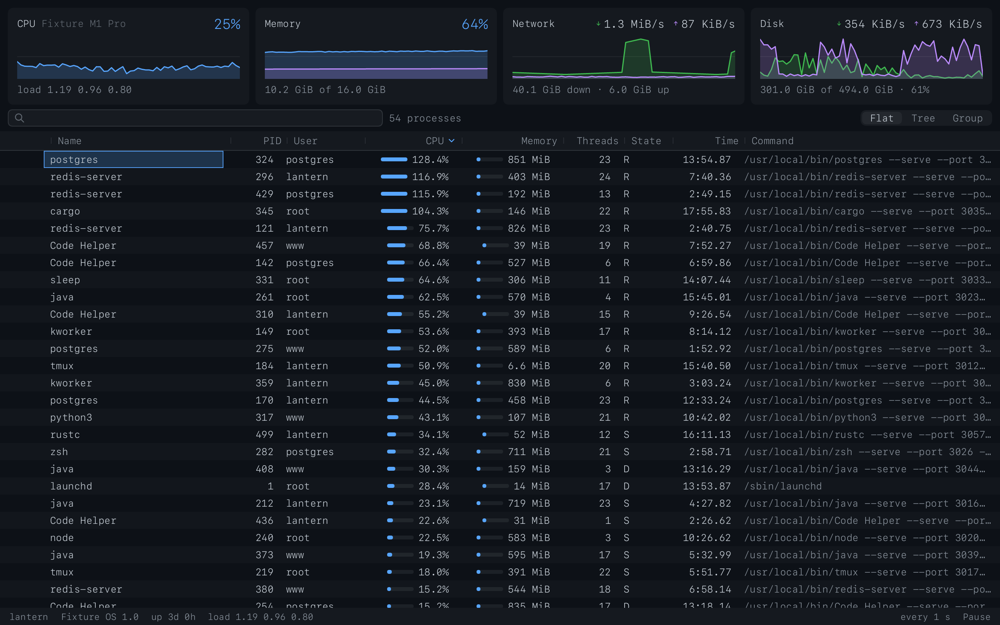
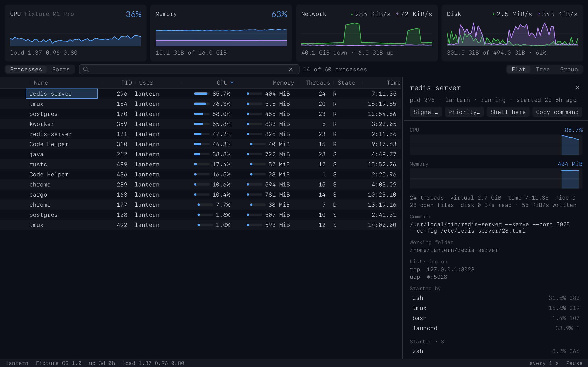
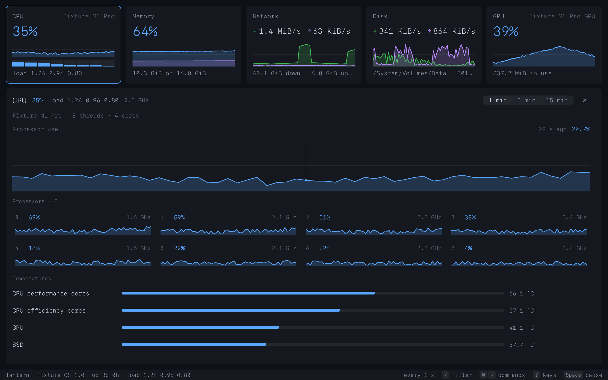
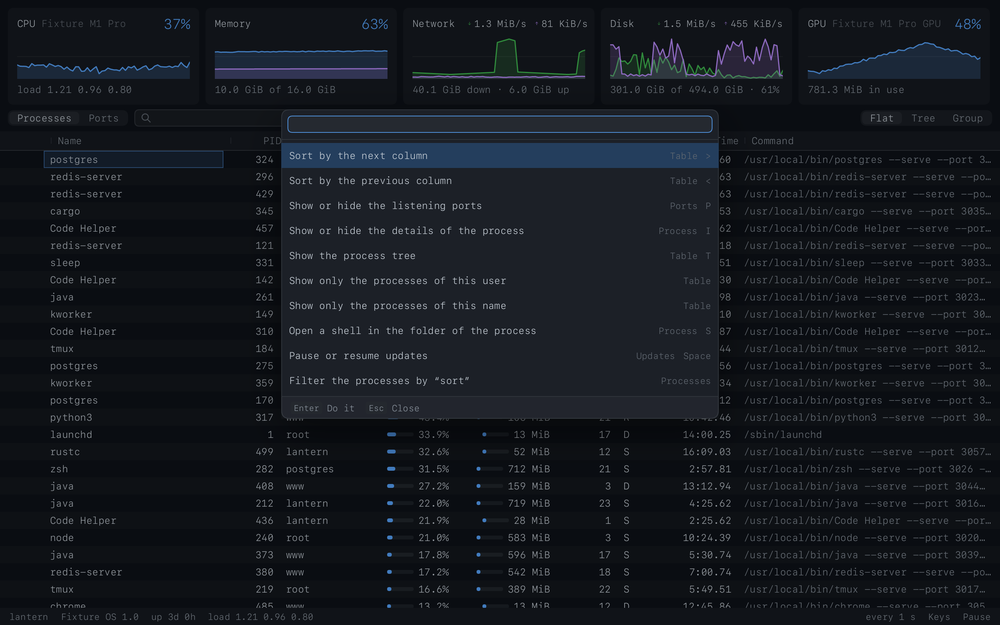
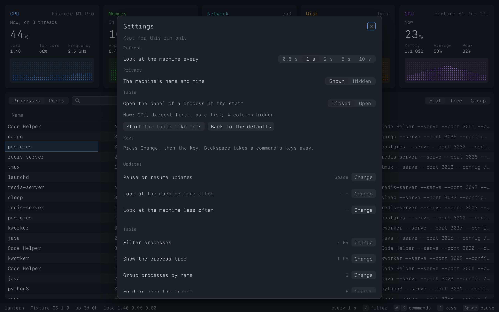
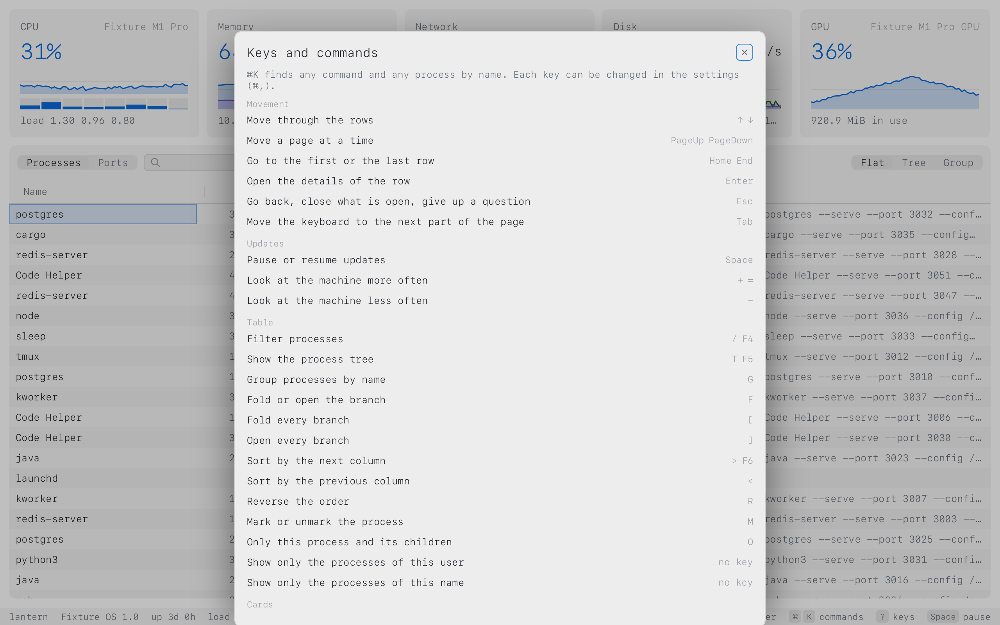

# toppen

A system monitor for the terminal pane, in the way of `top` and `btop`: what the machine is doing,
as cards with graphs and a table of its processes, drawn by the terminal in its own font and colours. It runs on the machine it is
started on, so over plain `ssh` it shows the server's own CPU, memory, network, disks and GPU.

toppen is a [pencere](https://github.com/bateri/pencere) app: the program is Rust, the view is a
page of pencere's kit, and both are one file. A terminal that hosts pencere (bateri) shows the view
in the pane; any other terminal is given a summary of the machine, as `top -l 1` prints one.







## Install

toppen is one file, with nothing to install beside it, for macOS on Apple silicon and Linux on
arm64 and x86_64:

```sh
curl -fsSL https://raw.githubusercontent.com/bateri/toppen/main/install.sh | sh
```

The installer takes the newest release (or `TOPPEN_VERSION=0.1.0`), checks it against the release's
`SHA256SUMS`, and puts it in `~/.local/bin` (`TOPPEN_INSTALL=<dir>` puts it elsewhere). A file a
browser downloads is quarantined by macOS; one curl downloads is not.

The Linux files are linked statically, so that one runs on any distribution; a static program cannot
open NVIDIA's library, so a Linux file from a release shows no NVIDIA card. A build made on the
machine (`cargo build --release`) does, and so do the AMD and Intel cards of the DRM drivers in
either.

There is no release yet; until there is one, build it from this repository (below).

## Use

```
toppen                    # the monitor, in a terminal that shows pencere views
toppen --once             # print a summary of the machine and exit
toppen --json             # the same summary, as one line of JSON
toppen --interval 2       # look at the machine every 2 seconds (0.5 to 10)
```

- **Space** pauses the updates and resumes them; the status line says when they are paused.
- **+** and **-** change how often the machine is looked at, from 0.5 to 10 seconds.
- The table lists the processes, the busiest first. Press a column's name to sort by it (again to
  reverse), drag the edge of a name to size the column, right-press a name to show or hide columns.
  **<** and **>** step the sort column, **r** reverses it.
- **/** filters: words match the name and the command line, `/regex/`, `!` for what does not match,
  `user:root`, `pid:42`, `state:R`, `cpu>50`, `mem>500M`. **Esc** clears it.
- **t** shows the processes as a tree, **g** groups the ones of one name, **f** folds or opens a
  branch (**[** and **]** every branch), **o** narrows the table to one process and what is below it,
  **m** marks a process.
- While the pointer is over the table (and for three seconds after a key) the rows keep their places,
  however the numbers change; "Order held" says how many would have moved, and pressing it lets go.
- **Enter** (or a double click) shows a process in a panel beside the table: what it takes, as graphs
  of the last minutes, its whole command line, where it works, who started it and what it started
  (press one to go to it), and its environment (what looks like a secret stays hidden until asked).
  **i** shows or hides it, **Esc** puts it away.
- What can be done to the process under the cursor: **k** sends a signal (a menu of TERM, INT, HUP,
  KILL, STOP, CONT, USR1 and USR2; toppen asks first, showing the whole command line, and offers to
  send it to what is below it too), **n** changes its priority, **s** opens a shell in its folder,
  **c** copies its command line, and **.** (or the right button) opens the menu of the row, which
  has these and more. A process of another user is shown, and left alone unless toppen runs as root.
  A signal names the process by its id and the second it started in: if it ended meanwhile and its
  id was used again, nothing is sent.
- Press a card (or **1** CPU, **2** memory, **3** network, **4** disk, **5** GPU) for its details in place of the
  table; **Esc** goes back. CPU: every processor with its own graph, frequencies and temperatures;
  memory: what it is made of (app, wired, compressed, cached files, free) and swap; network: each
  interface with its own graph (the arrows choose); disk: every volume and the reads and writes; GPU:
  each one's use over time, its memory, its engines and its temperature. Rest
  the pointer on a graph to read what it held and how long ago; **w** (or the buttons) changes how far
  back the graphs look: 1, 5 or 15 minutes.
- The GPU card is there only where the machine has a GPU that says how busy it is: an Apple
  Silicon or Intel Mac's accelerators, the AMD (and other) cards the Linux kernel keeps files for
  (`/sys/class/drm`), and NVIDIA's through its driver's library (`libnvidia-ml`) where that is
  installed. A machine with none has four cards, and no key for a fifth. With several GPUs the card
  speaks of the busiest and says how many there are; the details list each. The disk's reads and
  writes come from the storage drivers on a Mac and from `/proc/diskstats` on Linux.
- **p** (or the switch beside the filter) shows the listening ports instead of the table: each socket
  that waits for connections (TCP) or is bound to a port (UDP), the address it is on and the process
  that holds it. Filter by `:3000`, a name or a user; **Enter** shows the process in the table with its
  details, and the keys of a process (**k** a signal, **n**, **s**, **c**) are about the row's process.
  **a** copies the address. In the table, `port:3000` leaves the processes that listen there. Where the
  system does not let you look into a process (another user's, unless toppen runs as root) its sockets
  are listed without it, or not at all on macOS.
- Everything the keys do can be pressed with the mouse, and everything the mouse does has a key (or a
  row in the palette): **Cmd+K** (or **Ctrl+K**) opens the palette, which finds any command that can
  be done now, with its keys, and turns a name you type into a filter of the table (`:3000` into the
  process on that port). **?** (or **F1**, or "Keys" in the status line) lists every command with the
  keys it has now.
- htop's keys are there as second keys: **F1** the keys, **F2** the settings, **F4** the filter,
  **F5** the tree, **F6** the next sort column, **F7** the priority, **F9** a signal.



### Settings

**F2** (or **Cmd+,**) opens the settings, kept in `~/.config/toppen/settings.json`
(`$XDG_CONFIG_HOME/toppen/`, or `$TOPPEN_CONFIG_DIR`). The window changes them; the file can be
edited by hand:

```json
{
  "interval": 2,
  "sort": "memory", "descending": true, "mode": "tree", "hidden": ["threads"],
  "details": false,
  "privacy": false,
  "keys": { "pause": ["p"], "mark": ["x", "f3"], "fold_all": [] }
}
```

- `interval` is how often the machine is looked at (`--interval` is stronger); `sort`, `descending`,
  `mode` and `hidden` (columns) are how the table starts, and "Start the table like this" in the
  window writes the table as it is now; `details` opens the panel of a process at the start;
  `privacy` leaves out the machine's name and your own (the summary too).
- `keys` gives a command other keys than its own, by the id the help and the palette's rows share
  with the file (`pause`, `tree`, `signal`, `card_gpu`, ...). In the window, press **Change** and then
  the key; **Backspace** takes a command's keys away, **Reset** gives them back. A key is refused,
  with the reason, when it is not a key, when the table, the fields and the dialogs have it (the
  arrows, Enter, Esc, Tab, Home, End), when the terminal's own shortcuts have it (Cmd+P, Cmd+W, Cmd+1
  to 9 ...), when it is Option and a letter, or when another command has it.
- A file that cannot be read is left exactly where it is: toppen starts with the defaults, says so
  once, and writes nothing over it until it is fixed or removed.





The program looks at the machine only while its view is open and the updates are not paused.

## How it works

The program (Rust, on the `pencere` crate) looks at the machine with `sysinfo` and, where that does
not say it, the system's own interfaces (Mach and libproc and the I/O registry on macOS, `/proc`,
`/sys/class/drm` and NVIDIA's library on Linux). It keeps what it saw, and the model of the table
(order, filter, tree, groups, folds, history) is its own: the page tells it how the table is to be and
is sent only the rows in view, so a machine with thousands of processes costs the page nothing. The page
(Lua, on pencere's kit) draws and takes the keys and the pointer; it talks to the program only by the
calls and topics of `docs/calls.md`. A signal names its process by id and start time, and the program
reads the start again right before it sends: a process that ended and whose id was used again is not
signalled.

In a terminal that does not host pencere views, the same program prints the summary of the machine.

## Work on it

```
make fake-host   # once: the stand-in terminal the tests run toppen in (fetches pencere)
make check       # format, lints, the program's tests, the page's tests, the installer's tests
make build       # target/release/toppen
make dev         # run it from its files in a pane that hosts pencere
```

`make check` needs Rust 1.88 or later and Node 22 (for the installer's tests and the release tools).
It is the gate GitHub runs on every push and pull request, on Linux and macOS; how a release is made
is in RELEASING.md.

`docs/calls.md` is the contract between the page and the program.

## License

GPL-3.0-or-later.
